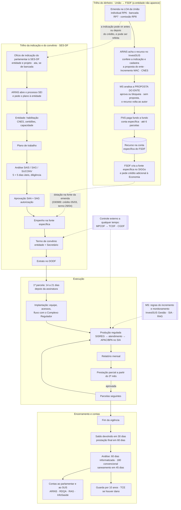

# fluxo_emenda.md — da indicação da emenda à prestação de contas final

O percurso inteiro de um convênio de emenda parlamentar federal com a SES-DF para
produção assistencial. Montado em 27/09/2026 a partir das normas do acervo, dos cinco
termos e dos pagamentos publicados. Cada etapa diz **quem faz, onde, com que regra e
prazo**, e o que os cinco convênios de 2026 mostram na prática.

Na SES-DF, o rito das emendas federais é o da **Portaria SES-DF 98/2025** (NM-086):
competências da ARINS, das áreas técnicas e do Fundo. O **Manual de Emendas
Parlamentares** (NM-085) detalha as atividades, mas é de 2023 — anterior à Portaria 98,
ao Decreto 48.727/2026 e à Portaria GM/MS 10.297/2026 —, e onde diverge valem as normas.

**Revisto em 27/09/2026.** A primeira versão punha o Ministério da Saúde como etapa entre
a indicação e o convênio. Isso estava errado. O convênio com a entidade corre inteiro na
SES-DF, e o dinheiro da emenda costuma já estar no Fundo de Saúde do DF quando a entidade
apresenta o plano e assina o termo. Na emenda dos nossos convênios, o FNS creditou o
Fundo em 05/03/2026, quase dois meses antes dos termos — mas depois do ofício do
deputado de fevereiro (AC-079).

Como ler: `NM-`, `IT-`, `CT-`, `DD-` são documentos do acervo; `OB-` obrigações;
`AC-` achados; `LI-` lições. `python consultar.py <id>` abre cada um.

**O que ainda não se sabe está marcado como ◌ lacuna**, com onde procurar.

---

## Dois trilhos que não andam juntos

| | trilho do dinheiro | trilho da indicação e do convênio |
|---|---|---|
| **entre quem** | Fundo de Saúde do DF (FSDF, pela ARINS) e Fundo Nacional de Saúde / MS | parlamentar, SES-DF e entidade |
| **o que decide** | se o recurso da emenda chega ao DF, e em que programa | qual entidade executa, o quê, com que plano e em quantas parcelas |
| **a entidade aparece?** | não, salvo quando a proposta federal já leva o CNES dela (art. 24, III) | é a protagonista: habilitação, plano, termo, execução, prestação |
| **quando** | a proposta e o empenho federal vêm primeiro, já com o valor de cada projeto; o crédito chega meses depois do empenho (na nossa emenda: empenho em dezembro, crédito em março) | em paralelo; a indicação pode vir antes ou depois do crédito e pode ser refeita, mas o plano e o termo costumam chegar com o dinheiro já no Fundo |
| **o MS analisa o plano da entidade?** | **não** — analisa a proposta do ente | **não** — quem analisa e aprova é a SES-DF (ARINS → SAA e SAG) |

O que liga os dois trilhos é pouco e concreto:

- o **número da emenda**, citado no termo;
- a **fonte de recursos específica** que o FSDF cria para cada conta aberta pelo FNS, e
  que a nota de empenho do convênio tem de indicar (NM-086, arts. 6º, III, e 7º, § 1º);
- os **avisos da ARINS** à área técnica, quando a proposta é aprovada e quando o FNS
  paga (NM-086, art. 4º, VII e VIII).

O empenho depende de dotação nessa fonte. Com o dinheiro no Fundo **e o crédito
adicional aberto** no orçamento do FSDF, nada do lado federal segura a assinatura.

---

## 1 · O trilho do dinheiro: da emenda ao Fundo de Saúde do DF

Corre entre o gestor do Fundo e o Ministério. A entidade não assina nada aqui, e o plano
dela não passa por aqui.

| # | etapa | quem | onde / documento | regra e prazo | fonte |
|---|---|---|---|---|---|
| 1.1 | **Emenda na lei orçamentária** | parlamentar, bancada ou comissão | LOA da União | individual (RP6); bancada (RP7): até 8 por bancada, só projeto estruturante, **vedada a individualização por membro**; comissão (RP8): ação de interesse nacional ou regional | NM-074, arts. 2º a 5º |
| 1.2 | **Destinação: incremento temporário de MAC** | — | funcional 10.302.5118.2E90 | temporário, sem ampliação permanente do repasse; limitado ao teto MAC; pode custear convênio com entidade sem fins lucrativos, desde que o ente celebre o instrumento (Lei 8.080, art. 24) | NM-032, arts. 22, 23, 27 (II e § 3º), 31 e 32 · OB-036, OB-037 |
| 1.3 | **Proposta do ente** | **ARINS**, em nome do FSDF, com a demanda da área técnica | **InvestSUS**: a ARINS identifica o recurso lançado, confere a indicação do parlamentar (ou a pede) e cadastra a proposta, com o CNES de destino — o da **secretaria** (conjunto das unidades), o da AgSUS ou o de um **estabelecimento** | conforme as diretrizes do MS; a ARINS acompanha a proposta e leva as diligências à área técnica | NM-086, arts. 4º, II a IV e VI, e 5º, I e II · NM-032, arts. 4º, 7º e 24 · OB-031, OB-035 |
| 1.4 | **Análise da proposta** | secretaria finalística do MS (SAES, para MAC) | InvestSUS | aprova ou bloqueia a **proposta do ente**; impropriedade não sanada vira impedimento técnico; **sem proposta, o recurso fica com o autor para trocar o beneficiário** | NM-032, arts. 9º, 11 e 26; NM-074, art. 10 · NM-086, art. 4º, VII |
| 1.5 | **Condições do ente** | SES-DF, não a entidade | CIR, CIB, Conselho de Saúde, Plano de Saúde e PAS | deliberação da CIR e resolução da CIB; instrumentos de planejamento atualizados e apresentados ao Conselho | NM-032, art. 10 · OB-030, OB-033 |
| 1.6 | **Repasse** | Fundo Nacional de Saúde | conta corrente específica, aberta pelo FNS em banco federal | fundo a fundo, em até seis parcelas; vedada a transferência para conta de finalidade diversa; a ARINS avisa a área técnica do pagamento | NM-032, arts. 12 e 32 · NM-086, arts. 4º, VIII, e 7º, § 4º |
| 1.7 | **Recepção no orçamento do DF** | **FSDF** | SIGGo: domicílio bancário, **fonte de recursos específica para cada conta**, vinculada pela Contadoria; guia de recebimento | pedido de **crédito adicional** à Secretaria de Economia para pôr o valor no orçamento (QDD) do FSDF, unidade 23901; descentralização à SES, unidade gestora 170101, quando couber | NM-086, art. 6º |

**O crédito adicional é a etapa que ninguém vê.** O dinheiro pode estar na conta e ainda
não ser empenhável: sem o crédito adicional aberto pela Economia, não há dotação na fonte
da emenda. É a pergunta a fazer à ARINS antes de prometer data de início (LI-042).

**Quando a proposta já leva o CNES da entidade** (art. 24, III), o MS vê o
estabelecimento, mas não o plano. Para as emendas regidas pela Portaria 10.297/2026, o
ente tem então **30 dias** da disponibilidade para repassar à entidade e **5 dias úteis**
para registrar o comprovante e o empenho no InvestSUS; a entidade pode avisar o MS se não
receber (NM-032, art. 103). É o único ponto em que o Ministério acompanha a entidade
diretamente.

**Na prática: a emenda dos nossos convênios, do empenho ao crédito (DD-007, AC-079).**

Os convênios 030989 (ISHP) e 030975 (IEV) gastam a emenda de bancada **202571080005** —
"Bancada do Distrito Federal / Emenda 5", de 2025, ação 2E90, R$ 190.916.934,00 no total,
todos empenhados ao FSDF.

| data | o quê | fonte |
|---|---|---|
| 16/10 a 31/12/2025 | FNS empenha a emenda ao FSDF em 29 notas; nada é pago em 2025 | DD-007 |
| 12/12 e 29/12/2025 | bancada do DF publica atas de indicação de beneficiários (◌ ainda não lidas) | site do Congresso |
| **22/12/2025** | empenhos NE515458 (**R$ 8.533.171,00**, o valor do 030989) e NE515459 (R$ 16.673.685,00, próximo do 030975) | DD-007 |
| 10/02/2026 | ofício de um deputado troca projeto e entidade da emenda | CT-001 |
| 04/03/2026 | FNS liquida 27 empenhos | DD-007 |
| **05/03/2026** | **FNS paga ao FSDF R$ 151.082.922,00** em 27 ordens bancárias, entre elas as dos dois empenhos acima | DD-007 |
| 02/04/2026 | ISHP assina o plano do 030989 | pt_ses_01 |
| 27 e 29/04/2026 | termos 030989 e 030975 assinados | IT-002, IT-003 |
| 08/05/2026 | FNS paga ao FSDF o último empenho, R$ 28.834.012,00 | DD-007 |
| 13 e 15/05/2026 | FSDF paga a 1ª parcela ao ISHP e ao IEV | DD-004 |
| 27/09/2026 | R$ 11.000.000,00 (NE507748) seguem em restos a pagar | DD-007 |

O que isso mostra:

- **O MS paga ao Fundo, não à entidade**, e o crédito veio no ano seguinte ao da emenda,
  como restos a pagar — o que casa com a fonte **1600** (exercício corrente) no termo.
- **O valor de cada projeto já estava no empenho federal de dezembro.** A emenda foi
  empenhada em 29 notas, e uma delas tem exatamente o valor do 030989 citado pelo MPCDF
  (R$ 8.533.171,00): tudo indica que a proposta do ente já separava os projetos, e
  que o recurso não entrou em bloco para a SES repartir depois.
- **O dinheiro estava no Fundo antes do plano e do termo**, mas **depois** do ofício do
  deputado. Entre o crédito (05/03) e a 1ª parcela (13/05) passaram dez semanas — o
  tempo do plano, da análise, do termo e, pela Portaria 98, da fonte específica e do
  crédito adicional.
- No termo, o dinheiro sai como fonte federal do SUS (1600), natureza 33.50.43 e
  programa de trabalho 10.302.6202.4205.0001, "em procedência ao Orçamento do Distrito
  Federal" (IT-001, cláusula 5ª).

◌ **Lacunas:** a data do crédito adicional no orçamento do FSDF (ARINS ou SIGGo); e o
que dizem as atas da bancada de 12/12 e 29/12/2025. O Painel Infosaúde de Emendas
Parlamentares, que a ARINS deve manter (NM-086, art. 4º, XII), não serviu em
27/09/2026: a página não mostra dados, e o formulário "Exportar CSV" devolve um link
para `dados_trakcare_alertas_ativos`, uma exportação do TrakCare que não é de emendas.
O arquivo não foi baixado.

## 2 · O trilho da indicação e do convênio: dentro da SES-DF

É aqui que o nosso plano vive. Todas as análises são da SES-DF.

| # | etapa | quem | onde / documento | regra e prazo | fonte |
|---|---|---|---|---|---|
| 2.1 | **Indicação** | autor da emenda | **ofício de indicação** à SES-DF (entidade, projeto, valor); emenda de bancada ou de comissão: indicação da bancada, em **ata** | pode chegar antes ou depois do crédito no FSDF, e pode ser refeita; se falta, a ARINS pede ao parlamentar | NM-086, art. 4º, III · NM-074, arts. 3º e 5º; NM-054, arts. 3º e 4º · CT-001 |
| 2.2 | **Abertura e pedido do plano** | **ARINS** — a única que inicia plano custeado por emenda | processo SEI, um por emenda ou ofício; ofício à entidade pedindo o plano de trabalho, conforme a Portaria 287 | a indicação parlamentar **não afasta** a análise nem supre falta de capacidade da entidade | NM-086, art. 4º, V · NM-013, art. 2º, II; NM-010, art. 4º, §§ 1º e 2º · NM-085, 7.6 e 7.7 |
| 2.3 | **Habilitação da entidade** | entidade, conferida pela SES | CNES no DF, documentação jurídica e fiscal, certidões do TCDF e do TCU, capacidade técnica e operacional, declarações | objeto compatível com o estatuto; o CNES de cada polo conferido contra a ficha do procedimento | NM-010, arts. 5º e 6º · OB-026 · `destilados/enquadramento_cnes.md` |
| 2.4 | **Plano de trabalho** | entidade | o documento que `metodo/plano/modelo.md` monta | conteúdo mínimo do Decreto; estrutura e metas pelas normas de custeio do MS; publicado no sítio do ente | NM-010, arts. 7º e 13; NM-032, arts. 7º e 27, § 5º · OB-011, OB-025, OB-031 |
| 2.5 | **Análise técnica** | SAIS (assistencial); áreas da SAG (financeira, estrutural); SUCONV/GPICP (instrução) | pareceres no SEI | **5 dias úteis** por área, prorrogáveis uma vez; diligência devolve **5 dias úteis** à entidade e outros 5 à área; análise expressa, conclusiva e fundamentada | NM-013, art. 2º, § 1º e incisos VI e VII; NM-010, arts. 8º e 9º |
| 2.6 | **Aprovação** | **SAA** aprova o assistencial, **SAG** o resto; manifestação jurídica quando exigida; autorização da autoridade | despacho ou termo de aprovação no SEI | custo acima do valor da emenda passa pelo Colegiado de Gestão | NM-013, arts. 2º e 5º; NM-010, art. 10 |
| 2.7 | **Empenho** | FSDF / DIOR / NEMP | nota de empenho no SIGGo, **com a fonte específica da emenda** | depende de dotação nessa fonte (1.7); o Manual dá **4 dias úteis** ao empenho; empenho sem instrumento celebrado até o fim do exercício é cancelado | NM-086, art. 7º, § 1º · NM-010, art. 15 · NM-085, atividade 5.16 · IT-001 a IT-005, cláusula 5ª |
| 2.8 | **Termo de convênio** | entidade e Secretário de Saúde | termo no SEI, molde da SES | vigência, valor, **condição suspensiva** (estrutura antes de iniciar), vedações, prestação parcial a partir do 3º mês | IT-001 a IT-005 · OB-041 a OB-052 |
| 2.9 | **Publicação** | SES-DF | extrato no DODF | eficácia do termo | termos, cláusula de publicação |
| 2.10 | **Apostilamento** | SES-DF | termo de apostilamento | só erro material, sem alterar objeto, valor ou vigência (Lei 14.133, art. 136) | IT-006 a IT-008 |

**O inciso III da Portaria 287.** Ele dispensa de aprovação da SES "os Planos de
Trabalho e/ou propostas, oriundos de Programas ou Emendas Parlamentares Federais,
aprovados pelo Ministério da Saúde" (NM-013, redação de 2024). Os cinco planos das
entidades não se valeram disso: foram analisados e aprovados pela SES-DF, com diligência
da GPICP no caso do 031061. A Portaria 98 manda pedir à entidade o plano "conforme
Portaria SES-DF nº 287" (NM-086, art. 4º, V). O que o MS aprova é a proposta do ente
(1.4), não o plano da entidade.

**Na prática.**

- **ISHP, oftalmologia (030989):** plano assinado em 02/04/2026; termo assinado em
  28/04 pela entidade e em 29/04 pelo Secretário; extrato no DODF em 30/04. O termo
  não foi apostilado e ainda cita "OCI em Ortopedia (DOA)" (AC-073).
- **IEV, três convênios (030975, 030976, 030977):**
  - termos assinados em 27/04 e 29/04; extratos no DODF em 30/04;
  - apostilados em 06/05: dois dos três termos traziam cláusula de oftalmologia em
    ortopedia, e nenhum tinha a regra do primeiro desembolso após a assinatura.
- **ISHP, oftalmologia 0 a 8 anos (031061):**
  - a GPICP pediu vigência, material de consumo item a item e cronograma de
    desembolso (Ofício 25/2026), e o ISHP respondeu em 12/05;
  - empenho em 02/07; termo assinado em 03/07 e 09/07; extrato no DODF em 13/07;
  - é o único dos cinco assinado depois do Decreto 48.727, de 09/06/2026, e ainda
    assim o termo cita o Decreto 44.330/2023 e a IN 01/2005, como os quatro de abril.
- Nenhum plano nem termo junta ou cita o ofício de indicação ou a ata da bancada
  (AC-078). As atas da bancada do DF sobre as emendas de 2025 estão publicadas no site
  do Congresso (orçamento 2025 → emendas coletivas → Distrito Federal): indicação em
  10/07, 19/08, 29/08, 03/10 e 05/12/2025; alteração em 30/10/2025; **indicação de
  beneficiários em 12/12/2025** e alteração de beneficiários em 29/12/2025. ◌ **Lacuna:**
  o conteúdo dessas atas, ainda não lidas.

## 3 · A execução

| # | etapa | quem | onde / documento | regra e prazo | fonte |
|---|---|---|---|---|---|
| 3.1 | **1ª parcela** | FSDF | ordem bancária para conta específica no **Banco do Brasil** (recurso federal); antes de cada ordem, o FSDF confere se fonte e conta de origem são as da emenda | logo após a assinatura | NM-086, art. 7º, §§ 2º e 3º · IT-006 a IT-008; termos, cláusulas 8.2 e 8.3 · OB-042, OB-046 |
| 3.2 | **Implantação** | entidade | equipe, acessos ao SISREG e ao TrakCare, fluxo com o Complexo Regulador, habilitação 38.01 e NGC quando couber, agendas | a estrutura prevista existe antes do início (condição suspensiva) | OB-048, OB-053, OB-054 |
| 3.3 | **Produção** | entidade, com a regulação da SES | SISREG → atendimento → **APAC ou BPA no SIA**, pelo instrumento da ficha; dados de regulação enviados ao MS | produção registrada é a que comprova; registro de parcela única segue regra própria do MS | NM-052; NM-050; NM-017 · OB-010 · LI-032 |
| 3.4 | **Relatório mensal** | entidade | relatório de atividades, metas, indicadores e intercorrências | mensal | OB-052 |
| 3.5 | **Prestação de contas parcial** | entidade; gestor do convênio | processo SEI | a partir do **3º mês**; **condiciona as parcelas seguintes** | OB-043 |
| 3.6 | **Parcelas seguintes** | FSDF | ordem bancária | conforme o cronograma e a prestação parcial; ajuste do plano precisa de aprovação e, quando exigível, **anuência do autor da emenda** | NM-010, arts. 11 e 14 |
| 3.7 | **Transparência e monitoramento** | entidade; ARINS; gestor do fundo | sítio da entidade; InvestSUS Gestão; Portal InfoSaúde; RDQA e RAG | a entidade publica o que recebeu e aplicou; a ARINS passa os dados à SUPLANS a cada quadrimestre e atualiza o InfoSaúde a cada semestre; o gestor mantém a situação do instrumento no InvestSUS | NM-086, art. 4º, X a XII · NM-032, arts. 92 e 105 · OB-038 |
| 3.8 | **Período eleitoral** | SES-DF e entidade | — | celebração, liberação e divulgação observam a Lei 9.504 (art. 73, VI: publicidade institucional e transferências voluntárias nos três meses anteriores ao pleito) | NM-010, art. 40; NM-076 · OB-028 |

**Na prática (pagamentos até 25/09/2026, DD-004).**

| convênio | assinatura | 1ª parcela | dias | depois |
|---|---|---|---|---|
| 030989 ISHP | 29/04 | 13/05 — R$ 2.028.681,07 | 14 | 07/07 e 28/08, R$ 1.011.741,99 cada |
| 030975, 030976, 030977 IEV | 29/04 | 15/05 — 25% de cada | 16 | **nenhuma**: as segundas, previstas para 15/07, 25/07 e 15/08, não saíram |
| 031061 ISHP | 09/07 | 30/07 — R$ 830.000,00 | 21 | próxima prevista no mês 4 |

A 1ª parcela saiu duas a três semanas depois da assinatura, o que é coerente com o
dinheiro já estar no Fundo. A SES-DF pagou pelo valor do plano e do quadro de metas,
não pelo do termo (AC-076). ◌ **Lacuna:** por que as parcelas do IEV pararam — prestação
parcial não aprovada ou representação no TCDF (CT-002). Onde procurar: o processo SEI de
cada convênio, se o acesso for liberado.

## 4 · Encerramento e contas

| # | etapa | quem | regra e prazo | fonte |
|---|---|---|---|---|
| 4.1 | **Fim da vigência** | — | a do termo, e não a do plano, quando divergem | IT-001 a IT-005 · AC-061, AC-074 |
| 4.2 | **Devolução e prestação final** | entidade | saldo devolvido em **30 dias**; prestação final em **60 dias**; sem envio, notificação com mais 30 | NM-010, art. 26 · OB-023, OB-044 |
| 4.3 | **Análise da prestação** | área técnica, após parecer do gestor | **60 dias** (informatizada) ou **180** (convencional), prorrogáveis uma vez; irregularidade sanada em **45 dias** | NM-010, arts. 27 a 30 |
| 4.4 | **Sanção e TCE** | SES-DF | glosa, suspensão, rescisão; Tomada de Contas Especial por omissão, dano ou ato antieconômico | NM-010, arts. 25, 34 e 35 |
| 4.5 | **Guarda** | entidade | documentos por **10 anos** | OB-045 |
| 4.6 | **Contas ao parlamentar** | a área técnica informa a execução à ARINS; a ARINS responde ao parlamentar, com relatório dos empenhos na fonte da emenda e ofício do Secretário | quando o parlamentar pede, e de ofício | NM-086, arts. 4º, IX, e 5º, V · NM-085, atividades 7.14 a 7.16 |
| 4.7 | **Controle externo** | MPCDF, TCDF, CGDF | a qualquer tempo, com pedido cautelar de suspensão | CT-001 a CT-004 |

**Na prática.** O MPCDF representou contra o 030989 em 12/05, **treze dias depois da
assinatura**, e contra os três do IEV em 18/05. O TCDF não suspendeu o do ISHP e mandou
ouvir a SES-DF e a entidade (CT-003). ◌ **Lacuna:** a decisão sobre o IEV.

---

## Onde o Ministério entra, e onde não entra

| momento | o MS faz | o MS não faz |
|---|---|---|
| proposta | analisa e aprova ou bloqueia a **proposta do ente** no InvestSUS; as diligências voltam à área técnica pela ARINS | não analisa o plano de trabalho da entidade |
| repasse | paga ao **FSDF**, fundo a fundo | não paga a entidade; quem paga é o FSDF |
| regras | define o que o incremento pode custear: temporário, teto MAC, funcional, metas | não aprova o convênio, o termo nem o cronograma |
| monitoramento | recebe a produção no SIA, a situação do instrumento no InvestSUS Gestão e o RAG | não fiscaliza o convênio: isso é da SES-DF, da CGDF e do TCDF |
| exceção | quando a proposta leva o CNES da entidade, cobra o repasse em 30 dias e pode ser avisado pela entidade (art. 103) | — |

## Os prazos, numa lista

| prazo | o quê | fonte |
|---|---|---|
| 15 + 5 dias | comissão delibera indicações e publica atas | NM-074, art. 5º |
| 5 + 5 dias úteis | análise de cada área técnica da SES; diligência | NM-013 |
| 4 dias úteis | empenho, depois da autorização | NM-085, atividade 5.16 |
| até o fim do exercício | empenho de instrumento não celebrado é cancelado | termos, cláusula 5ª |
| logo após a assinatura | 1ª parcela (medido: 14 a 21 dias) | IT-006 a IT-008; DD-004 |
| 30 dias da disponibilidade | repasse à entidade quando ela é a beneficiária final na proposta federal; comprovante no InvestSUS em 5 dias úteis | NM-032, art. 103 |
| a partir do 3º mês | prestação de contas parcial, condição das parcelas seguintes | OB-043 |
| mensal | relatório de atividades | OB-052 |
| a cada quadrimestre | ARINS passa os dados das emendas à SUPLANS, para o RDQA | NM-086, art. 4º, XI |
| a cada semestre | ARINS atualiza as emendas no Portal InfoSaúde | NM-086, art. 4º, XII |
| 30 dias do fim | devolução do saldo | NM-010, art. 26 |
| 60 dias do fim | prestação de contas final | NM-010, art. 26; OB-044 |
| 60 ou 180 dias | análise da prestação; 45 para sanear | NM-010, art. 30 |
| 10 anos | guarda de documentos | OB-045 |
| 3 meses antes do pleito | restrições do art. 73 da Lei 9.504 | NM-076; OB-028 |

## O que o fluxo ensina para o nosso plano

1. **O plano é lido só pela SES-DF.** Não há rodada no Ministério: a ARINS pede o
   plano, as áreas analisam e ele sai com duas aprovações, SAA no assistencial e SAG no
   resto. A resposta à diligência tem 5 dias úteis; o plano que já traz o que a GPICP
   costuma pedir poupa uma rodada (LI-037).
2. **Saber de onde vem o dinheiro antes de fechar o cronograma.** Número e tipo da
   emenda, o ofício de indicação (e a ata, se for de bancada ou comissão) e a
   confirmação da ARINS de que o recurso está no FSDF, em que fonte específica, e de que
   o crédito adicional já entrou no orçamento do Fundo. Com dotação na fonte, a 1ª
   parcela sai em duas a três semanas da assinatura; sem ela, o convênio espera (LI-042).
3. **As condições federais são do ente, não da entidade.** CIR/CIB, Plano de Saúde, PAS
   e Conselho condicionam o crédito ao DF; no plano, o que cabe é registrar a coerência
   com o Plano de Saúde e a ciência do Conselho, que o MPCDF cobrou (LI-033).
4. **Termo assinado não é todas as parcelas.** As seguintes dependem da prestação
   parcial do 3º mês e, no IEV, pararam (LI-012, LI-041).
5. **Em ano eleitoral**, assinatura, liberação e divulgação passam pela Lei 9.504 (LI-043).
6. **O controle externo age cedo**: treze dias depois da assinatura, no caso do ISHP.
