<!-- Manual operacional da OCI 09.02.01.002-6 (Avaliação Cardiológica) da SES de Sorocaba (BookStack,
     estante-ses.sorocaba.sp.gov.br), competência 12/2025. Cópia local do texto limpo; a análise está em
     ../../fonte_sorocaba.md. Duas telas (img/5veimage.png e img/sb4image.png) têm o nome e o prontuário
     do paciente tarjados. -->

# Fluxo Operacional – Consultas OCI Cardiologia

**Antecipação de Horários:** Antecipar em 15 minutos todas as consultas de primeira vez, a fim de viabilizar a realização prévia do ECG.

**Abertura da Fila e Escuta Inicial:** O técnico de enfermagem deverá abrir a fila do médico e chamar o paciente para o ECG a partir da Escuta Inicial.

**Chamada dos Pacientes pelo Médico:** O médico deve chamar somente os pacientes que já realizaram o ECG, identificados pelo ícone "Passou pela escuta" no sistema.

**Registro Clínico:** Lançar CID(s) compatíveis com a OCI, Ao finalizar o atendimento, registrar o procedimento correspondente no sistema. (Diego já criou o procedimento; código pendente de inserção nesta instrução.)

**Preenchimento da APAC:** Após o atendimento, o setor administrativo deverá preencher a APAC com todas as informações pertinentes:

- Dados completos do paciente
- CID compatível
- Procedimento registrado
- Solicitar carimbo e assinatura médica.

**Autorização:** Encaminhar a APAC preenchida para a CREDAC com o objetivo de autorização e disponibilização do número da APAC.

**Processamento e Integração ao Sistema:** Após o retorno das APACs autorizadas, a Policlínica deverá realizar a digitação no sistema específico, conforme orientações da OCI.

**Anexar posteriormente a APAC autorizada ao PEC.**

# Visão Geral da OCI Cardiologia

A Operação de Cuidado Integrado (OCI) em Cardiologia é um fluxo padronizado para garantir atendimento qualificado, registro clínico estruturado e processamento adequado das APACs relacionadas ao procedimento **OCI Avaliação Cardiológica (0902010026)**. Em Sorocaba, sua aplicação inicial ocorrerá exclusivamente em consultas de **Primeira Consulta** com o **Médico Cardiologista (CBO 225120)**.

Como o sistema ainda não automatiza todas as etapas da OCI, parte do processo será conduzida pela equipe administrativa e de enfermagem, com apoio de exportação de listas e organização prévia dos atendimentos.

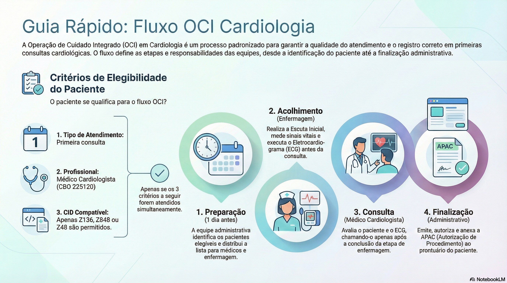

---

## 1. Objetivo da OCI Cardiologia

A OCI tem como metas:

- Padronizar o processo das consultas cardiológicas de primeira avaliação.
- Garantir a **realização prévia do eletrocardiograma (ECG)** antes da consulta médica.
- Estruturar corretamente a **Escuta Inicial** e seus registros obrigatórios.
- Garantir que o cardiologista chame o paciente apenas quando a etapa de enfermagem estiver concluída.
- Lançar de forma padronizada o procedimento **0902010026 – OCI Avaliação Cardiológica**.
- Facilitar e organizar o trabalho da equipe administrativa para correta emissão das APACs.
- Manter rastreabilidade clínica e administrativa com anexação da APAC ao prontuário.

---

## 2. Pacientes que Devem Seguir o Fluxo OCI

A OCI Cardiologia é aplicada SOMENTE aos pacientes com:

1. **Tipo de atendimento:** Primeira consulta
2. **CBO do profissional atendente:** 225120 – Médico Cardiologista
3. **CID compatível**, sendo permitido exclusivamente:
    - **Z136 – Exame especial de rastreamento de doenças cardiovasculares**
    - **Z848 – História familiar de outras afecções especificadas**
    - **Z48 – Outro seguimento cirúrgico**

Esses três elementos devem coexistir para a aplicação da OCI.

---

## 3. Identificação Prévia dos Pacientes (Processo Obrigatório – Novo)

Um dia antes das consultas, a equipe designada pela Gestão da Unidade, conforme organização local, deve realizar a **identificação prévia dos pacientes** que se enquadram na OCI.

### 3.1 Onde fazer isso

Ambulatório → Solicitação → Recepção de Serviços

### 3.2 Filtros obrigatórios

- **Tipo de atendimento:** Primeira consulta
- **CBO:** 225120 – Médico Cardiologista

O sistema exibirá a lista de todos os pacientes do dia seguinte que deverão obrigatoriamente seguir o fluxo da OCI.

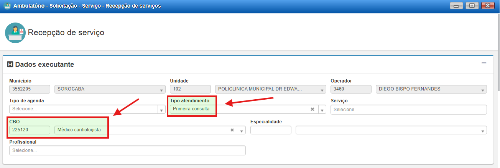

### 3.3 Exportação ou impressão da lista

A lista exibida pode ser exportada no ícone localizado na região inferior da tela, permitindo formatos como:

- MS-Excel
- CSV
- TXT
- XML
- JSON

### 3.4 Entrega da lista à equipe

A lista exportada deve ser entregue fisicamente (ou enviada por e-mail institucional) para:

- **Equipe médica (cardiologistas)**
- **Equipe de enfermagem (responsável pela Escuta Inicial e ECG)**

Essa lista funciona como guia de conferência, garantindo que:

- Apenas os pacientes da lista sigam o fluxo OCI.
- O cardiologista só chame esses pacientes após o símbolo de “Escuta Inicial realizada”  aparecer na fila.

---

## 4. Etapas Principais da OCI

A OCI Cardiologia segue o fluxo abaixo, detalhado nas demais páginas deste capítulo:

1. **Identificação prévia dos pacientes (1 dia antes)**
2. **Recepção do paciente no dia da consulta**
3. **Escuta Inicial obrigatória pela enfermagem**
    - CIAP2 com código 42 Eletrocardiograma
    - Sinais vitais e antropometria
    - Procedimento 0301040079 (preparo para ECG)
4. **Realização do ECG**
5. **Atendimento médico**
    - Avaliação do ECG
    - Registro de CID permitido
    - Lançamento do procedimento OCI
6. **Identificação administrativa via relatório “Procedimentos realizados por paciente”**
7. **Emissão e autorização da APAC**
    - Preenchimento manual Ou registro digital estruturado via: **Regulação → APAC → Solicitação Laudo (APAC)**
8. **Digitação da APAC autorizada no sistema específico**
9. **Anexação da APAC autorizada ao prontuário eletrônico (PEC)**

---

## 5. Ponto Importante: APAC Digital via Sistema

Embora a APAC ainda não seja gerada automaticamente pela própria consulta, o sistema permite registrar sua versão digital através do menu:

**Regulação → APAC → Solicitação Laudo (APAC)**

Vantagens desse método:

- Importa automaticamente os dados cadastrais do paciente.
- Evita erros de digitação de informações básicas.
- Facilita organização e guarda da documentação.
- Padroniza o modelo para futuras automações.

A equipe administrativa deve:

1. Identificar o paciente pelo relatório.
2. Abrir a tela de “Solicitação Laudo (APAC)”.
3. Preencher os campos obrigatórios.
4. Imprimir ou encaminhar digitalmente à CREDAC.
5. Após autorização, anexar ao PEC.

---

## 6. Responsabilidades por Etapa

| Etapa | Responsável | Atividade |
| --- | --- | --- |
| Identificação prévia | Equipe designada pela gestão da unidade | Filtrar pacientes por Primeira Consulta + CBO 225120 |
| Lista de pacientes | Administração | Exportar e entregar à equipe |
| Escuta Inicial | Enfermagem | CIAP2 42, sinais vitais, preparo para ECG |
| ECG | Enfermagem | Realizar exame antes da consulta |
| Consulta médica | Cardiologista | Avaliar ECG, registrar CID, lançar OCI |
| Relatório de produção | Administração | Identificar atendimentos que geraram OCI |
| APAC | Administração | Preencher, registrar digitalmente e enviar à CREDAC |
| Digitação | Policlínica | Digitar APAC autorizada |
| PEC | Policlínica/Administração | Anexar APAC ao prontuário |

---

## 7. Importância da Padronização Operacional

A organização prévia garante que:

- A enfermagem receba antecipadamente a lista de pacientes que precisam de Escuta + ECG.
- O cardiologista saiba quais pacientes dependem da Escuta Inicial antes de serem chamados.
- A administração consiga prever e preparar a demanda de APACs.
- O processo permaneça rastreável, auditável e padronizado, mesmo antes da automatização completa.

[Vídeo explicativo (YouTube)](https://youtu.be/Ji1e5QJXQrY)

# Identificação Prévia dos Pacientes da OCI Cardiologia

A Operação de Cuidado Integrado (OCI) em Cardiologia aplica-se **exclusivamente** aos pacientes agendados como **Primeira Consulta** com profissionais de CBO **225120 – Médico Cardiologista**.
Para garantir que todos os pacientes sigam o fluxo obrigatório da OCI, é necessário que a equipe designada pela gestão da unidade realize a **identificação prévia** da lista de pacientes no dia anterior à consulta.

Esta etapa é fundamental para orientar a enfermagem sobre quem deverá passar pela Escuta Inicial e ECG, e também para que o médico saiba quais pacientes devem ser chamados apenas após a conclusão dessas etapas.

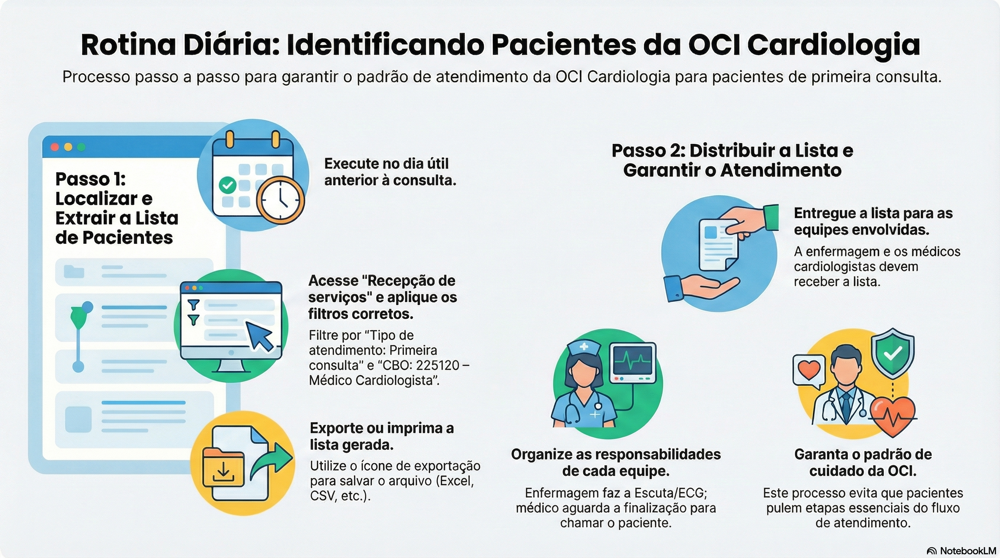

---

## 1. Quando realizar esta verificação?

- **Sempre no dia util anterior** às consultas de Cardiologia.
- Recomenda-se que seja feita por equipe designada pela gestão da unidade, conforme organização local.

---

## 2. Onde localizar os pacientes da OCI?

**Ambulatório → Solicitação → Recepção de serviços**

Nesta tela será possível buscar todos os agendamentos futuros da unidade.

---

## 3. Configuração dos filtros obrigatórios

Na área de filtros, selecione:

- **Tipo de atendimento:** Primeira consulta
- **CBO:** 225120 – Médico Cardiologista

Esses dois filtros combinados garantem a lista exata dos pacientes que **devem obrigatoriamente seguir o fluxo OCI**.

---

## 4. Exportação ou impressão da lista

Após filtrar:

1. Role a tela até a tabela de agendamentos
2. Clique no ícone de exportação
3. Escolha o formato desejado:
    - MS-Excel
    - CSV
    - TXT
    - JSON
    - XML
4. Salve ou imprima a lista

Essa lista será o documento base para toda a unidade seguir o fluxo OCI com precisão.

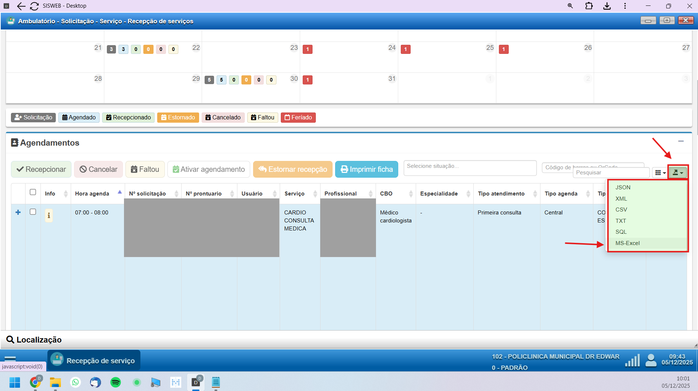

---

## 5. Entrega da lista à equipe envolvida

A lista deve ser encaminhada para:

- **Enfermagem**
    - Para saber **quem deve passar pela Escuta Inicial**
    - Para garantir que o ECG seja realizado antes da consulta
- **Médicos Cardiologistas**
    - Para saber **quem é paciente OCI**
    - Para chamar o paciente **somente** após o símbolo de “Escuta Inicial realizada” aparecer na fila

Recomenda-se impressão física ou envio por e-mail institucional da unidade.

---

## 6. Importância desta etapa

A checagem prévia permite:

- Garantir que nenhuma consulta de primeira vez seja atendida sem o ECG prévio
- Evitar que pacientes de retorno entrem indevidamente no fluxo da OCI
- Evitar que o cardiologista chame pacientes sem a Escuta Inicial
- Organização e agilidade para a enfermagem no início do expediente
- Facilitar o acompanhamento diário das APACs (pois se sabe previamente quantas OCI ocorrerão)

Sem essa etapa, não é possível assegurar o padrão assistencial esperado da OCI.

---

## 7. Resumo da Rotina Diária (1 dia antes)

1. Acessar a tela **Recepção de Serviços**
2. Filtrar por:
    - Tipo de Atendimento: **Primeira Consulta**
    - CBO: **225120 – Médico Cardiologista**
3. Exportar ou imprimir a lista
4. Entregar a lista à Enfermagem e ao Médico
5. Arquivar uma cópia para conferência do dia seguinte

[Vídeo explicativo (YouTube)](https://youtu.be/cf-gHa-ToiU)

# Papel da Enfermagem (Escuta Inicial + ECG)

A etapa da Enfermagem é essencial para garantir a correta execução do fluxo OCI Cardiologia. É durante a Escuta Inicial que são registrados sinais vitais, CIAP2, antropometria, glicemia (quando aplicável) e o procedimento preparatório para o ECG, além de permitir que o sistema sinalize ao médico que o paciente está pronto para ser chamado.

Somente após a Escuta Inicial e a realização do ECG, o paciente pode seguir para a consulta com o cardiologista.

Este capítulo descreve todas as ações obrigatórias da enfermagem, com pontos específicos para inserção de imagens da interface do sistema.

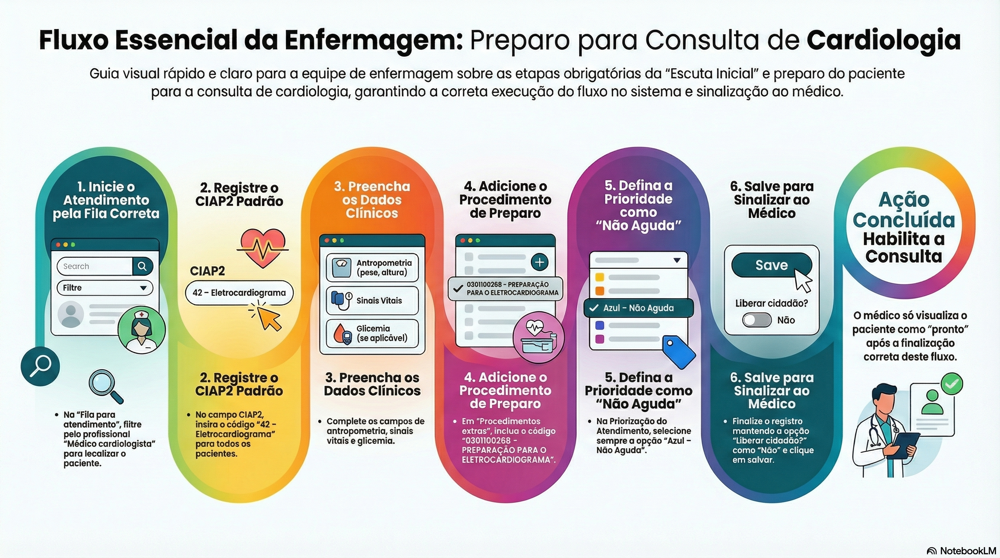

---

## 1. Recebimento da Lista de Pacientes OCI

No início do dia, a equipe de enfermagem deve receber a lista impressa ou por email contendo todos os pacientes identificados previamente como candidatos à OCI Cardiologia.

Essa lista permite:

- Planejar o atendimento
- Garantir que todos passem pela Escuta Inicial
- Acompanhar quem já realizou o ECG
- Evitar chamados indevidos pelo médico

---

## 2. Abertura da Escuta Inicial

Quando o paciente comparecer à unidade, abra a Escuta Inicial a partir da fila do cardiologista, para isso, altere o filtro do profissional da fila ou especialidade na fila.

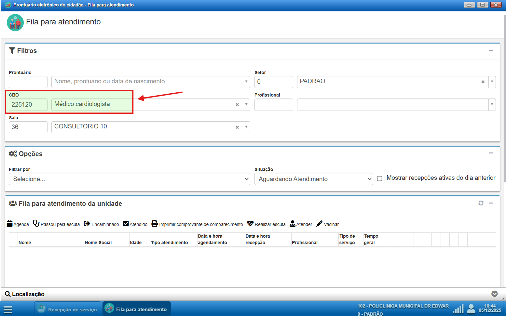

O registro da escuta inicial deve ser feito sempre clicando no ícone 

O sistema apresentará a tela padrão de Escuta Inicial contendo:

- Dados do paciente
- Campos estruturados
- Motivo da consulta
- CIAP2

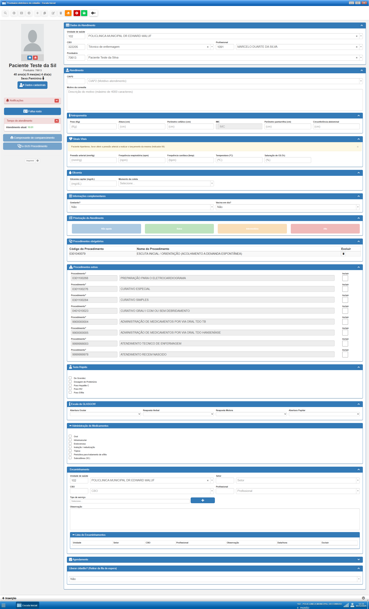

---

## 3. Registro do CIAP2

No campo de CIAP2, deve ser lançado:

**CIAP2 – 42 (Eletrocardiograma)**

Este código padroniza a Escuta Inicial para todo paciente da OCI Cardiologia, garantindo consistência no registro clínico.

O campo “Motivo da consulta” pode ser preenchido de forma descritiva, conforme relato do paciente.

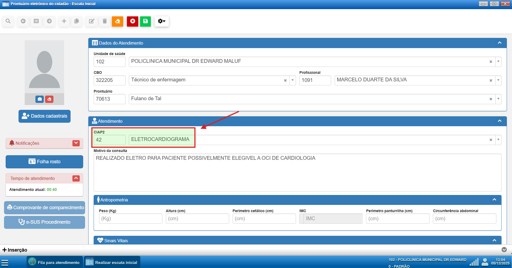

---

## 4. Preenchimento Completo dos Campos Estruturados

É importante destacar que alguns outros campos podem servir de apoio adicional e fundamental ao atendimento médico, portanto, na Escuta Inicial também é indicado, sempre que possível, conter todos os dados estruturados preenchidos. São eles:

### 4.1 Antropometria

- Peso
- Altura
- IMC (automático ou manual)

### 4.2 Sinais Vitais

- Pressão arterial
- Frequência cardíaca
- Saturação
- Frequência respiratória
- Temperatura

### 4.3 Exames de Enfermagem

- Glicemia capilar (quando aplicável)

Esses campos estruturados fornecem ao cardiologista uma visão clínica segura para análise prévia antes da consulta.

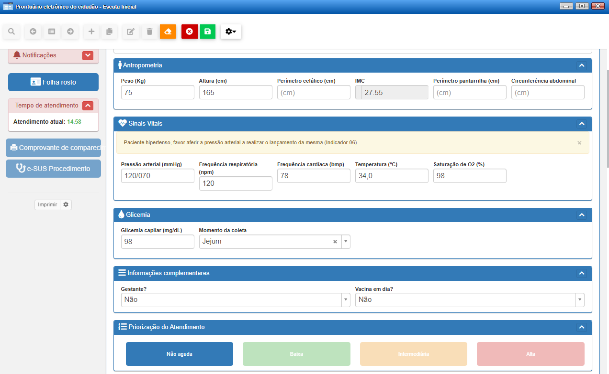

---

## 5. Priorização do Atendimento

A priorização na Escuta Inicial **não é** uma classificação de risco, embora utilize cores no sistema.

Para todas as consultas da OCI Cardiologia, a priorização deve ser:

**Azul – Não Aguda**

Isso diferencia o fluxo OCI de outros atendimentos e organiza a fila corretamente.

---

## 6. Procedimento Pré-Consulta (Obrigatório)

Note que ao preencher os campos estruturados de antropometria, sinais vitais e exames, o sistema colocará alguns procedimentos automáticamente em Procedimentos Obrigatórios, porém, também será necessário registrar o procedimento executado pela enfermagem:

**0301040079 – Preparação para o Eletrocardiograma**

Esse procedimento deve ser lançado sempre que o paciente estiver na OCI Cardiologia.

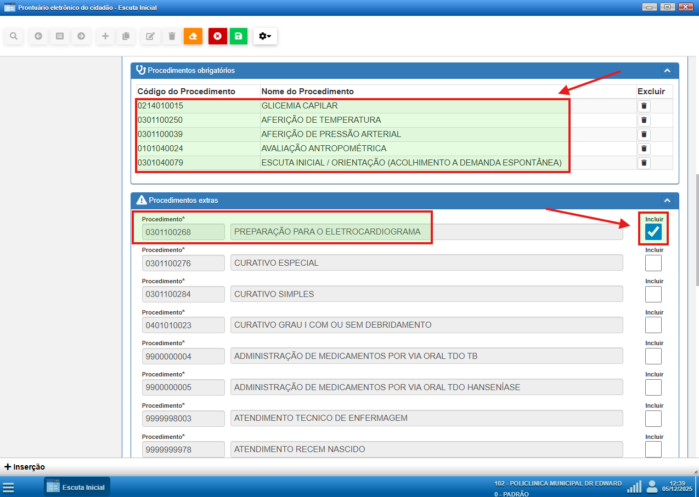

---

## 7. Conclusão da Escuta Inicial

Antes de salvar:

- Verificar se todos os campos estão preenchidos
- Confirmar o CIAP2 42
- Confirmar a Priorização Azul
- Confirmar o Procedimento 0301040079

Após conferir:

**Selecione “Paciente não liberado”**
**Salve a Escuta Inicial**

Isso fará com que o sistema exiba o ícone de “Escuta Inicial Realizada” na fila de atendimento médico.

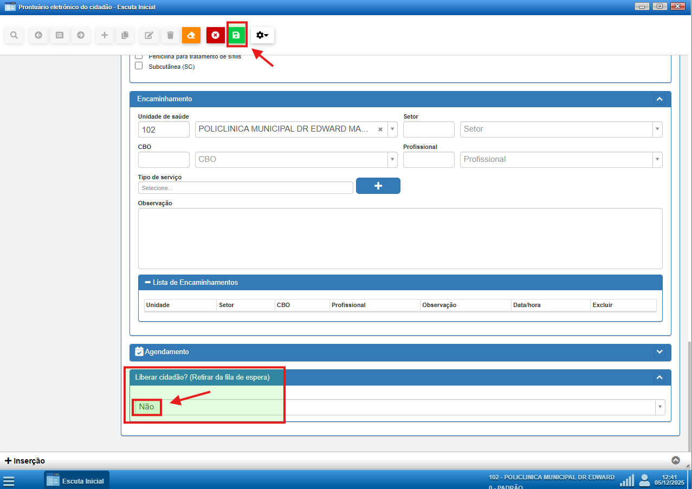

---

## 8. Importância do Registro Completo

A Escuta Inicial é o *gatilho* que habilita o cardiologista a chamar o paciente.
Sem o símbolo de Escuta Inicial  concluída, o paciente **não deve** ser chamado para a consulta.

A realização adequada desta etapa:

- Evita falhas no fluxo
- Organiza a unidade
- Garante segurança clínica
- Permite que a OCI seja executada sem retrabalho
- Minimiza erros na APAC e no faturamento

[Vídeo explicativo (YouTube)](https://youtu.be/maNC5Pa3_Pw)

# Atendimento Médico (Cardiologista)

O atendimento médico da OCI Cardiologia segue a estrutura de registro clínico orientado por problemas (SOAP), semelhante ao modelo utilizado no e-SUS APS.
Nesta etapa, o cardiologista deve avaliar os dados registrados pela Enfermagem, analisar o ECG realizado previamente, registrar o CID compatível e finalizar o atendimento exclusivamente com o procedimento **OCI Avaliação Cardiológica (0902010026)**.

Todas as ações descritas abaixo são obrigatórias para caracterizar um atendimento OCI.

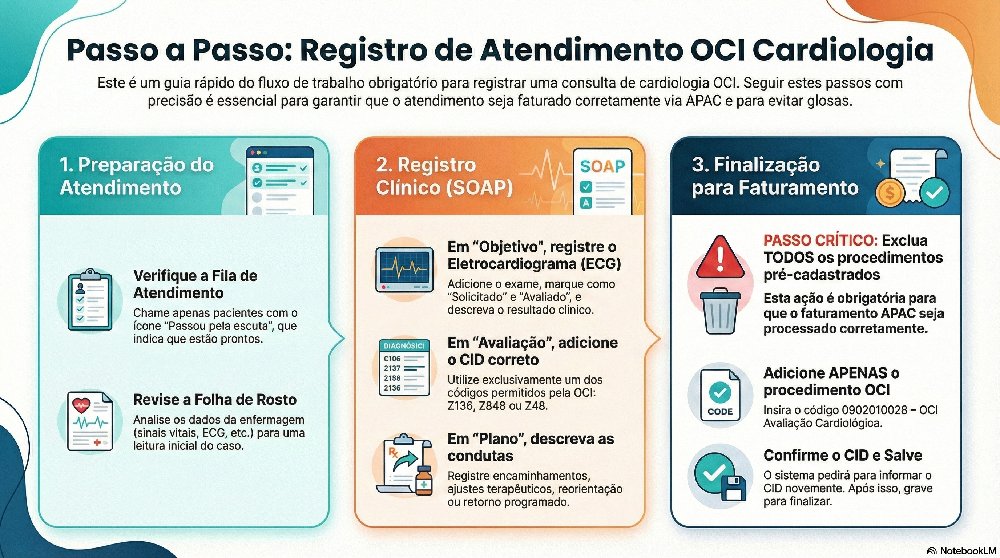

---

## 1. Verificar na fila se o paciente está apto (Escuta Inicial Realizada)

Antes de chamar qualquer paciente, o médico deve verificar na fila se o registro apresenta o ícone de **“Escuta Inicial realizada”**.

Esse ícone indica que:

- A Enfermagem abriu a Escuta Inicial
- O ECG foi preparado e executado
- Todos os dados foram estruturados
- O paciente está pronto para atendimento

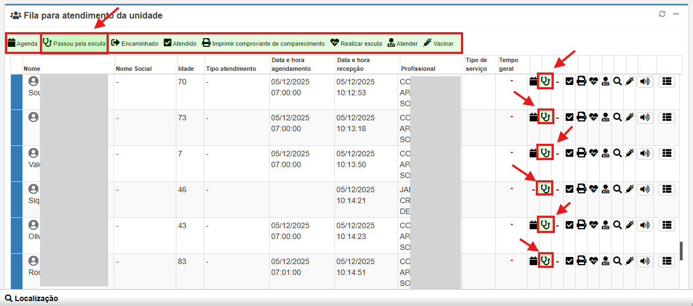

> **Importante:** O Médico Cardiologista deverá ter em mãos a lista de pacientes de primeira consulta que podem ser elegíveis a OCI, portanto, apenas esses pacientes devem ser considerados atender apenas quando a escuta inicial estiver concluída. Pacientes sem esse ícone **NÃO devem ser chamados**, mesmo que constem na agenda do dia.

---

## 2. Abertura do atendimento – Folha de rosto

Ao abrir o atendimento, o sistema exibe primeiro a **Folha de Rosto**, contendo:

- Dados pessoais do paciente
- Informações registradas pelo técnico (antropometria, sinais vitais, glicemia etc.)
- Lista de problemas e condições ativas/inativas
- Resumo clínico

Esta tela deve ser usada pelo médico para uma leitura inicial do caso.

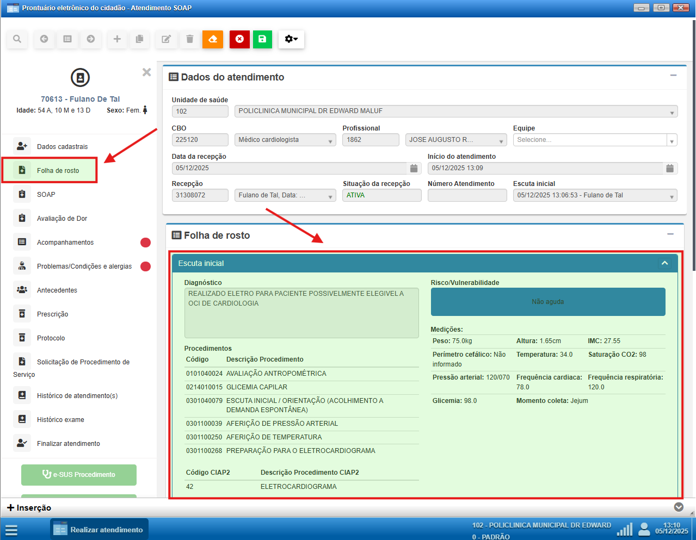

Após revisar, o médico deve prosseguir para a aba SOAP.

---

## 3. Registro do atendimento na aba SOAP

O atendimento é registrado seguindo as quatro seções do modelo SOAP:

- **S – Subjetivo**
- **O – Objetivo**
- **A – Avaliação**
- **P – Plano**

A seguir, os itens obrigatórios dessa etapa.

---

### 3.1 OBJETIVO — Registro do Eletrocardiograma

O ECG foi realizado previamente pela equipe de enfermagem durante a Escuta Inicial.

Para registrar corretamente no sistema:

1. Ir até **OBJETIVO**
2. Localizar o **grupo de exames**
3. Selecionar o exame:
    **0211020036 – Eletrocardiograma**
4. Marcar as opções:
    - “Solicitado”
    - “Avaliado”
5. Clicar na seta para **adicionar o exame ao atendimento**

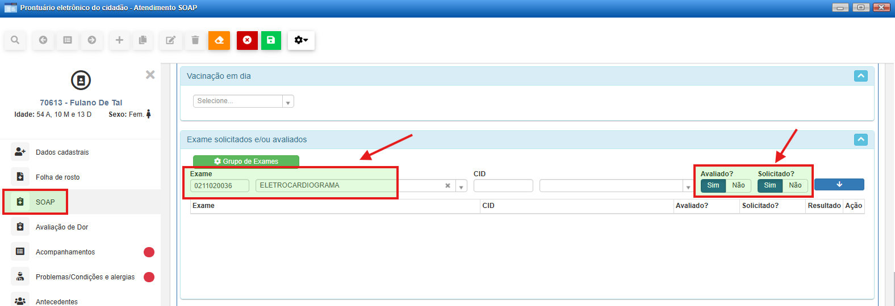

Quando o exame for incluído:

- Aparecerá um ícone de lápis para registrar o **resultado** do exame
- O médico deve clicar nesse ícone

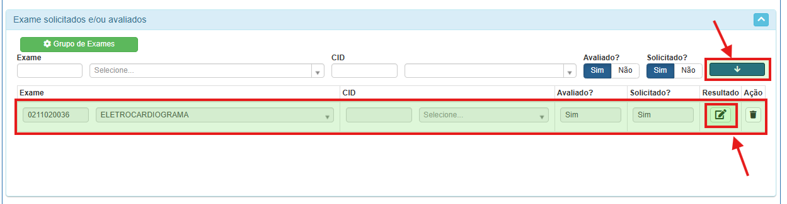

### O que preencher no campo de resultado

- **Data de Solicitação:** data do atendimento
- **Data de Realização:** data do atendimento
- **Data do Resultado:** data do atendimento
- **Texto descritivo:** análise clínica do médico sobre o ECG realizado

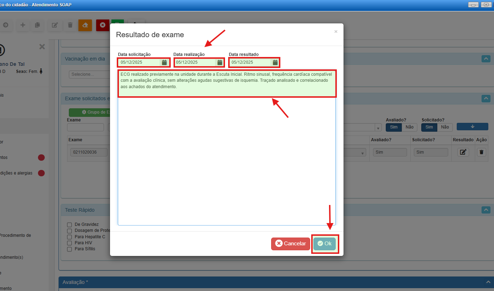

---

### 3.2 AVALIAÇÃO — Registro do CID + descrição clínica

Na aba **Avaliação**, o médico deve:

1. Selecionar um dos **3 CIDs permitidos pela OCI**:
    - Z136
    - Z848
    - Z48
2. Clicar na seta para **adicionar o CID ao atendimento**
3. Registrar a avaliação clínica do paciente (texto livre)

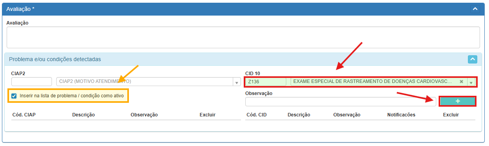

> **Observação opcional:** Se desejado, o médico pode marcar **“Inserir na lista de problema/condição como ativo”,** Caso considere o diagnóstico parte do conjunto de problemas ativos do paciente.

---

### 3.3 PLANO — Condutas

O médico deve registrar:

- Condutas
- Encaminhamentos
- Ajustes terapêuticos
- Reorientação
- Retorno programado

---

## 4. Finalização do Atendimento

Após completar o SOAP, o médico deve ir até a aba **Finalizar Atendimento**.

Essa etapa exige atenção porque envolve:

### 4.1 Exclusão de todos os procedimentos pré-cadastrados

Isso inclui:

- Procedimento de eletrocardiograma
- Procedimentos automáticos configurados para o CBO
- Qualquer outro que apareça por padrão

### Por que excluir todos?

> **Regra de faturamento:**
> Na OCI Cardiologia, o atendimento será faturado via **APAC**.
> Quando um atendimento irá gerar APAC, **nenhum procedimento exclusivo de BPA pode ser faturado junto**.
> Por isso, todos os procedimentos devem ser removidos.

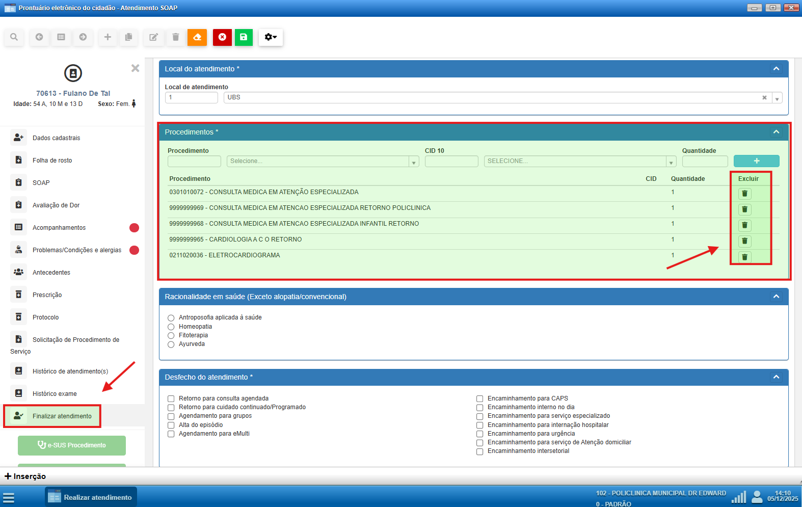

### 4.2 Registrar somente o procedimento da OCI

Adicionar:

**0902010026 – OCI Avaliação Cardiológica**

### 4.3 Informar novamente o CID

O sistema solicita a repetição do CID (Z136, Z848 ou Z48).

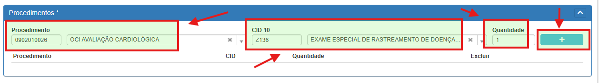

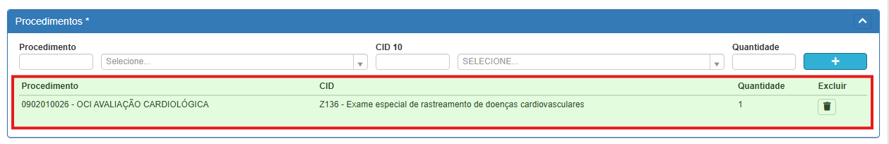

Após conferir:

- Gravar o atendimento
- Encerrar

---

## 5. Finalização — O que acontece após salvar

Quando o atendimento é salvo corretamente:

- O sistema registra o procedimento OCI
- A consulta fica disponível no relatório “Procedimentos realizados por paciente”
- A equipe administrativa identificará o atendimento e fará a emissão da APAC
- A APAC será posteriormente anexada ao prontuário após autorização

---

## 6. Resumo das Responsabilidades do Médico na OCI

1. Chamar apenas pacientes com Escuta Inicial realizada
2. Verificar dados da Escuta Inicial na Folha de Rosto
3. Registrar ECG no OBJETIVO
4. Preencher Avaliação com o CID permitido
5. Registrar condutas no PLANO
6. Excluir todos os procedimentos automáticos
7. Lançar somente: **0902010026 – OCI Avaliação Cardiológica**
8. Repetir o CID na finalização
9. Salvar o atendimento

---

## 7. Observação Importante sobre o Fluxo da APAC

O médico **não emite** a APAC.
Mas tudo que ele registra impacta:

- Qual paciente aparecerá no relatório
- A correta autorização pela CREDAC
- A ausência de glosas
- A rastreabilidade no prontuário

Portanto, seguir o processo exatamente como descrito é essencial.

[Vídeo explicativo (YouTube)](https://youtu.be/mtB8oGzIuJI)

# Fluxo Administrativo das APACs

A etapa administrativa da OCI Cardiologia é responsável por garantir que todo atendimento classificado como OCI seja devidamente convertido em APAC, autorizado pelo CREDAC, digitado no sistema específico e anexado ao prontuário eletrônico.

O processo é obrigatório para todo atendimento finalizado com o procedimento: **0902010026 – OCI Avaliação Cardiológica.**

O Sistema de Gestão Pública de Saúde já está configurado para **não enviar o atendimento ao BPA** quando somente esse procedimento é lançado — exatamente como exigem as regras federais para OCI.

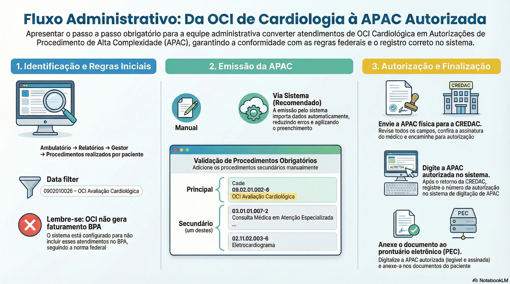

---

## 1. Identificando os Atendimentos que Geraram OCI

Ao final do expediente, a equipe administrativa deve verificar quais pacientes geraram produção OCI.

Caminho:

**Ambulatório → Relatórios → Gestor → Procedimentos realizados por paciente**

Filtros obrigatórios:

- Data do atendimento
- Procedimento: **0902010026 – OCI Avaliação Cardiológica**

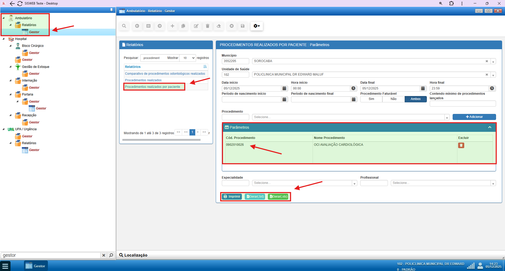

A lista obtida corresponde a todos os pacientes que devem ter APAC emitida.

---

## 2. Importante: Comportamento Validado do Sistema (Versão v25.11.06)

Foi realizado teste no [ambiente de homologação/treino](https://sisweb-tst.sorocaba.sp.gov.br/) ([v25.11.06](https://sisweb-tst.sorocaba.sp.gov.br/)) registrando um atendimento SOAP conforme descrito nesse manual, com:

- Registro do ECG
- Registro do CID compatível
- Registro do plano
- **Procedimento único lançado: 0902010026**
- Exclusão de qualquer outro procedimento BPA

Resultando em um atendimento que não constou no arquivo BPA

Isso confirma que o sistema municipal está alinhado às normas nacionais de OCI, que **proíbem BPA** em consultas que gerarão APAC.

> Os quatro anexos de teste do município (dois SOAP, o relatório de procedimentos por paciente e o arquivo BPA de 11/2025) não entram no repositório: têm nome, CPF, CNS e endereço de pacientes. Ficaram em `~/Downloads/02-Saude-SUS/OCI-Cardiologia/oci-cardiologia-anexos/`.

Por isso, a equipe administrativa deve sempre:

- Conferir o relatório
- Gerar APAC para todos os pacientes listados
- Nunca esperar BPA para OCI

---

## 3. Emissão da APAC — Duas Formas Possíveis

A APAC pode ser emitida:

1. **[Manual](http://www1.saude.rs.gov.br/dados/1199297634903Laudo%20de%20APAC%20-%20P%E1gina%20Principal%20%5Bfolha%201%5D.pdf) ([formulário físico tradicional](http://www1.saude.rs.gov.br/dados/1199297634903Laudo%20de%20APAC%20-%20P%E1gina%20Principal%20%5Bfolha%201%5D.pdf))**
2. **Pelo próprio SIS Sorocaba (recomendado)**

Ambos são aceitos, desde que resultem em impressão assinada e entregue à CREDAC.

---

### 3.1. Opção 1 — APAC Manual

No formulário físico, a equipe deve preencher:

- Dados completos do paciente (CNS, CPF, nome, endereço, data de nascimento, etc.)
- CID utilizado no atendimento:
    - Z13.6
    - Z84.8
    - Z48
- Procedimento principal:
    **0902010026 – OCI Avaliação Cardiológica**
- Procedimentos secundários obrigatórios (ver item 4)
- Unidade solicitante/executante
- Profissional solicitante
- Data da consulta
- Assinatura e carimbo do médico

---

### 3.2. Opção 2 (Recomendada) — APAC via Sistema

Para facilitar o preenchimento, o SIS Sorocaba oferece uma tela específica para geração da APAC digital:

Caminho:

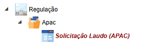

Essa tela importa automaticamente:

- Dados cadastrais do paciente
- Dados administrativos da unidade
- Dados do profissional

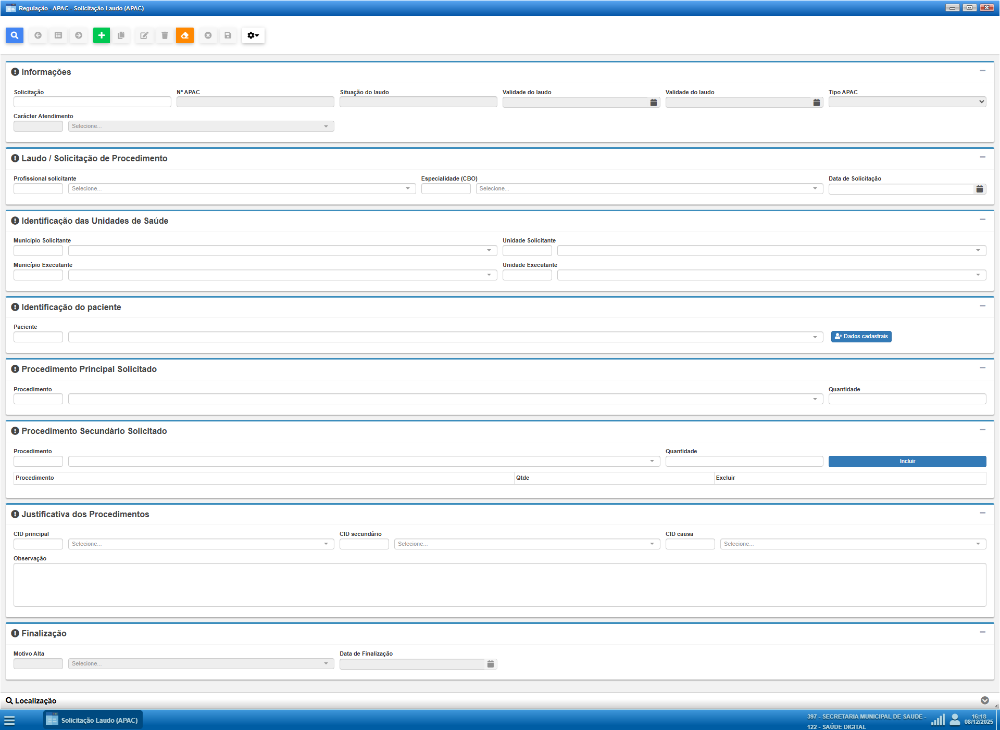

### Como preencher:

1. Selecionar o paciente
2. Informar o profissional solicitante e o CBO
3. Definir data da solicitação
4. Preencher “Identificação das Unidades de Saúde” (solicitante/executante)
5. Incluir:
    - Procedimento principal: **0902010026**
    - Procedimentos secundários obrigatórios (ver item 4)
6. Selecionar o CID
7. Preencher justificativas, quando necessário
8. Salvar
9. Clicar em **Imprimir APAC**

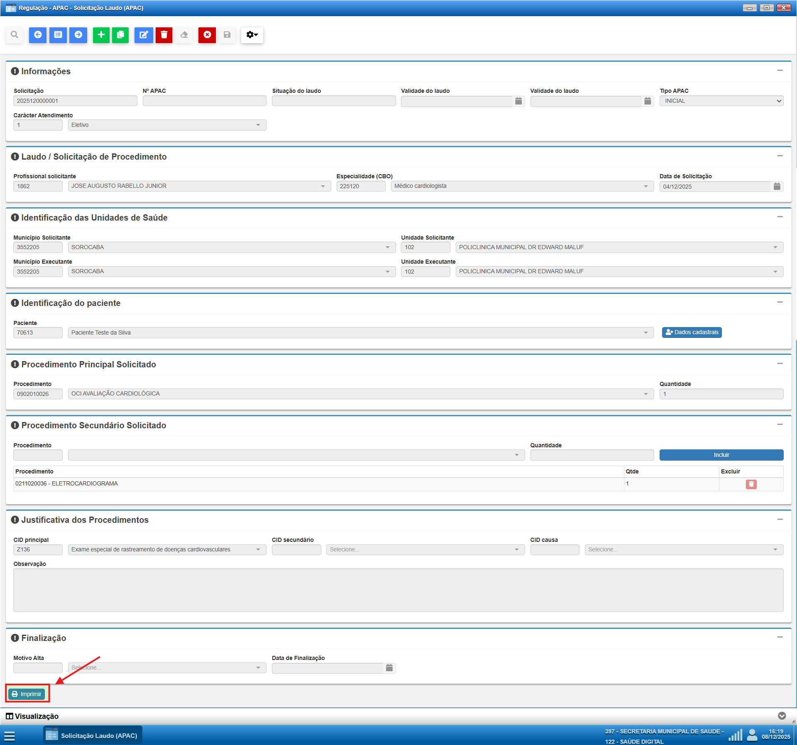

**Atenção:**
Esta tela NÃO está integrada automaticamente ao SOAP do paciente.
A equipe deve identificar manualmente os pacientes no relatório.

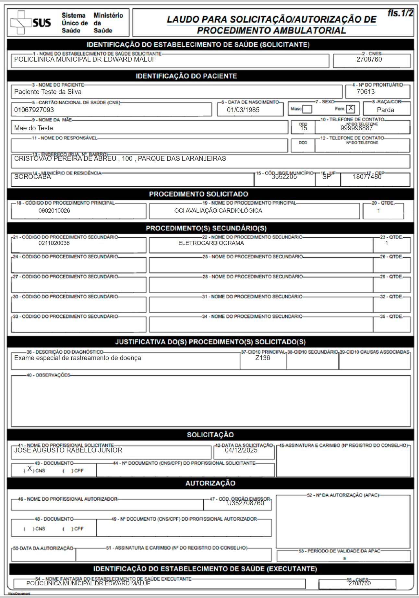

---

## 4. Regras Federais Obrigatórias (PMAE / SIA / Portaria SAES/MS nº 2.331/2024)

A APAC de OCI Cardiologia deve cumprir as regras federais do Ministério da Saúde.

### 4.1 CID permitidos

- **Z13.6** – Rastreamento de doenças cardiovasculares
- **Z84.8** – História familiar de outras afecções especificadas
- **Z48** – Outro seguimento cirúrgico

*(Os mesmos utilizados pelo cardiologista no SOAP.)*

---

### 4.2 Procedimentos obrigatórios na APAC

### Procedimento principal:

- **09.02.01.002-6 — OCI Avaliação Cardiológica**

### Procedimentos secundários obrigatórios:

A APAC deve conter **pelo menos um** destes:

- **03.01.01.007-2 — Consulta Médica em Atenção Especializada**
- **02.11.02.003-6 — ELETROCARDIOGRAMA**

*(O sistema não os insere automaticamente — a equipe deve incluí-los manualmente.)*

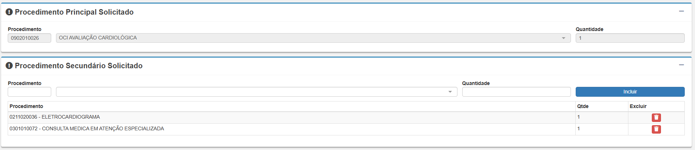

---

## 5. Envio da APAC à CREDAC

Após emissão:

1. Revisar todos os campos
2. Conferir:
    - CID
    - Procedimento principal
    - Procedimentos secundários
3. Verificar assinatura e carimbo do médico
4. Encaminhar fisicamente à CREDAC
5. Aguardar autorização e retorno do número da APAC

---

## 6. Digitação da APAC Autorizada

Com o número autorizado:

- Registrar a APAC no sistema de digitação
- Preencher todos os campos obrigatórios
- Salvar

---

## 7. Anexação ao Prontuário Eletrônico (PEC)

Caminho:

**Usuários → Documentos Anexos**

Digitalizar e anexar a APAC autorizada.

**Requisitos:**

- Documento completo
- Legível
- Com assinatura + carimbo
- Número da APAC destacado

---

## 8. Resumo Operacional da Equipe Administrativa

| Etapa | Ação |
| --- | --- |
| Identificação | Consultar relatório "Procedimentos realizados por paciente" |
| Emissão | Preencher APAC (manual ou sistema) |
| Regras PMAE | CID compatível + procedimentos secundários obrigatórios |
| Autorização | Enviar à CREDAC |
| Digitação | Registrar no sistema de APAC |
| Anexação | Digitalizar e anexar ao PEC |

[Vídeo explicativo (YouTube)](https://youtu.be/1cm5XdVVswk)

# Fluxograma

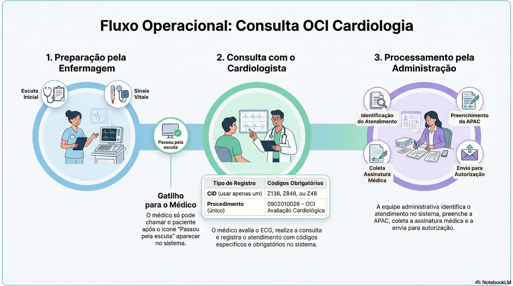