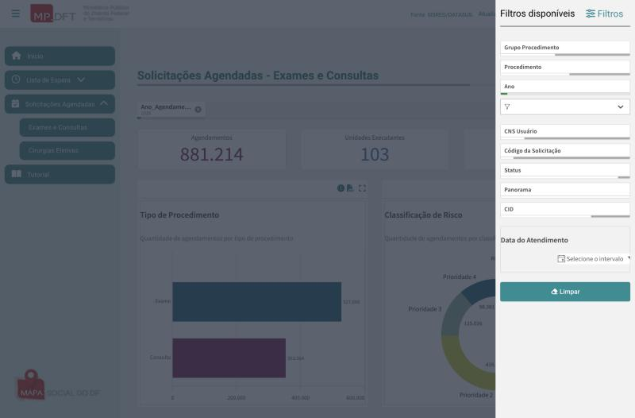
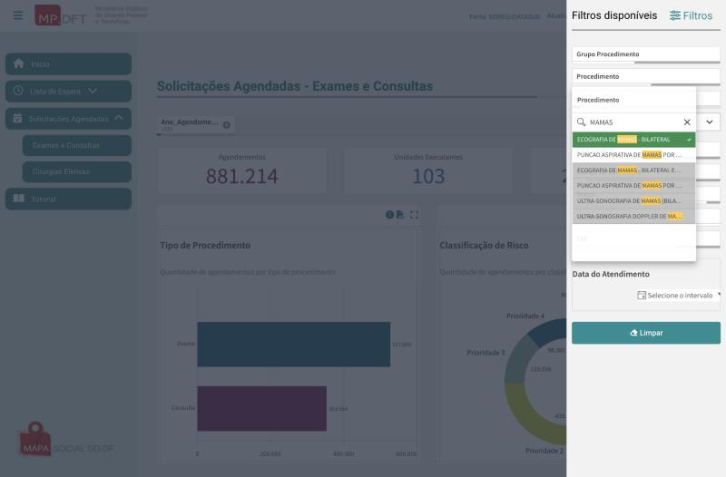
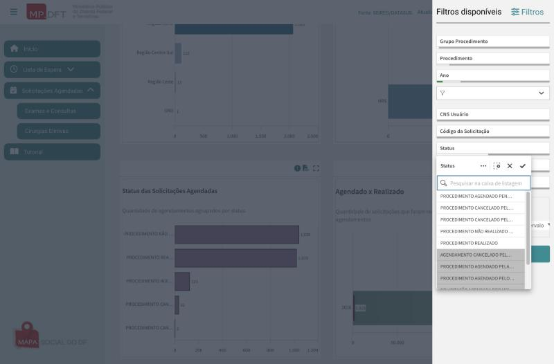
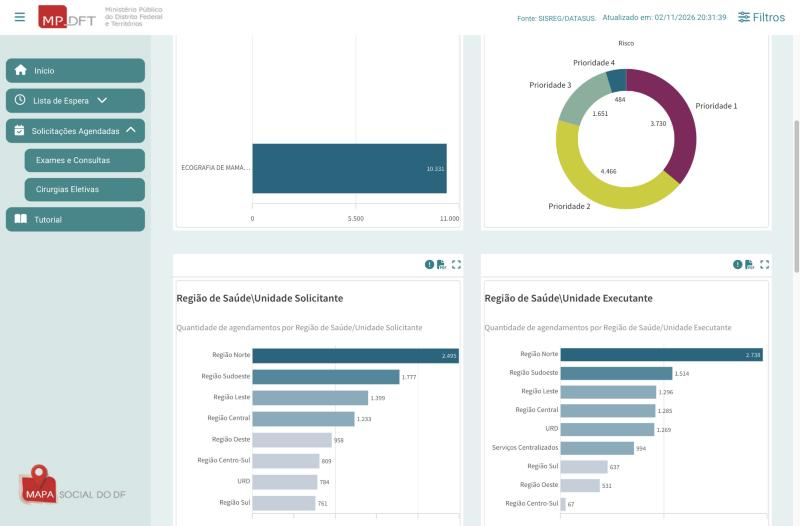
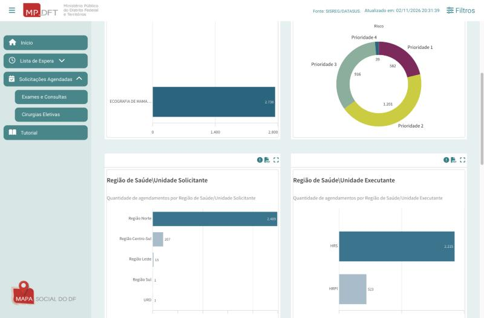
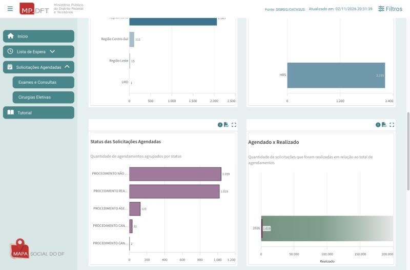
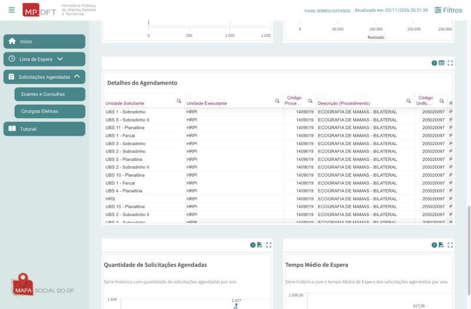

# Como ver no Mapa Social quem realizou um exame ou uma consulta

Passo a passo testado em 02/11/2026, com a recarga das 20h31, no exemplo da mama bilateral no HRS. Os números da
tela batem com a coleta do agente `mapa-social` da mesma noite: 2.215 agendamentos, 1.019 realizados e 1.039 faltas
(`../../dados/fontes/mapa_social_20261102_executante_c.md`).

Painel: <https://paineis-ext.mpdft.mp.br/extensions/mapasauderegulamentacao/mapasauderegulamentacao.html>

## 1. Abrir a tela de agendamentos

No menu (as três linhas no canto de cima, à esquerda): **Solicitações Agendadas → Exames e Consultas**.

A tela abre com um filtro já aplicado: **Ano de agendamento = 2026** (a etiqueta cinza abaixo do título). Para
tirar, clique no X da etiqueta.

## 2. Escolher o exame ou a consulta

Clique em **Filtros** (canto de cima, à direita). Os filtros são: Grupo Procedimento, Procedimento, Ano, CNS do
usuário, Código da Solicitação, Status, Panorama, CID e Data do Atendimento.

Em **Procedimento**, digite parte do nome (por exemplo, MAMAS), marque o nome exato da fila e confirme no ✓.

- **Consulta:** o nome é o da fila, por exemplo "CONSULTA EM ORTOPEDIA". Não use o código: todas as consultas
  especializadas têm o mesmo (03.01.01.007-2).
- **Período:** em **Data do Atendimento**, escolha o intervalo. É a data em que o exame acontece.
- **Só o que foi feito:** em **Status**, marque "PROCEDIMENTO REALIZADO". Sem isso, a tela conta todo agendamento,
  inclusive falta e cancelamento.

## 3. Ver quem executou

Desça até o gráfico **Região de Saúde \ Unidade Executante**. Ele mostra os agendamentos por Região de Saúde da
unidade que executou (ou URD, contratado, serviços centralizados).

Clique na barra de uma Região e confirme no ✓: o gráfico desce para as **unidades** daquela Região. Na mama de
2026, a Região Norte tem o HRS (2.215) e o HRPl (523).

O gráfico ao lado, **Região de Saúde \ Unidade Solicitante**, é quem pediu o exame, e não quem fez.

## 4. Ver quantos foram realizados

Clique na barra da unidade e confirme no ✓. O gráfico **Status das Solicitações Agendadas** mostra, só para ela:
realizados, não realizados por falta, agendados ainda sem desfecho e cancelados. No HRS: 1.039 faltas, 1.019
realizados, 123 agendados sem desfecho e 34 cancelados.

## 5. A lista, agendamento por agendamento

A tabela **Detalhes do Agendamento** mostra cada agendamento: unidade solicitante, unidade executante, código e nome
do procedimento, código unificado (SIGTAP) e risco. Não mostra data, status nem paciente.

## O que o painel não mostra

- **O profissional:** não há nome de médico nem de quem laudou.
- **O convênio:** a tela dá a unidade, e não o contrato. A ligação de uma unidade a um convênio (como o IEV) é por
  indício.
- **O exame feito dentro de uma OCI:** ele não passa pelo agendamento do SISREG; só a consulta de entrada aparece.
- **O mês a mês por unidade:** a tela não tem esse gráfico. Para isso, filtre a **Data do Atendimento** mês a mês,
  ou peça a coleta ao agente `mapa-social` (é como saem as abas Quem oferta).

Para limpar tudo e começar de novo: **Filtros → Limpar**.
